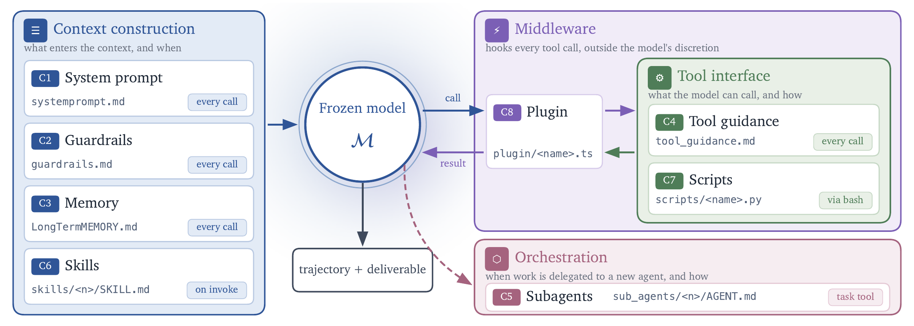

<p align="center">
  <a href="README.md">English</a> | <b>简体中文</b>
</p>

<h3 align="center">
  <br>
  SecAgentHarness: 网络安全智能体评测基准与能力框架
</h3>

<p align="center">
  <a href="https://arxiv.org/pdf/2610.14224"></a>
  <a href="https://harness2.github.io"></a>
  <a href="docs/ARCHITECTURE_zh.md"></a>
  <a href="docs/BENCHMARKS_zh.md"></a>
  <a href="LICENSE"></a>
</p>

> [!NOTE]
> **上游开源基石与致谢声明**：
> SecAgentHarness 的核心递归智能体运行套件引擎基于 [Google Research 的 Harness² 开源项目](https://github.com/google-research/harness2)（[论文链接](https://arxiv.org/abs/2610.14224)）。本项目在其创新的“提议–探测–组合（Propose–Probe–Compose）”递归运行套件架构基础上深度扩展，面向网络安全攻防、渗透测试、漏洞挖掘与防御分析等多元化网安基准场景以及 8 大组件体系提供完整的评测与能力支撑。

<p align="center">
  <a href="docs/BENCHMARKS_zh.md#jobbench">
    
  </a>
</p>

**智能体运行套件（Harness）** 是围绕基础模型构建的一整套使之能够作为智能体（Agent）行动的系统组件，包括提示词（Prompts）、工具（Tools）、记忆（Memory）、技能（Skills）、编排（Orchestration）等。**运行套件优化（Harnessing）** 则是优化这套系统的过程。

Harness² 是一个即插即用（plug-and-play）的 **开放世界递归智能体运行套件优化（Recursive Agent Harnessing）** 框架，面向智能体遭遇设计阶段未见新任务的场景。它在保持模型权重冻结不变的前提下，串联了两个层次的递归循环：

* **任务级递归（Task-level recursion）**：针对当前任务，通过对比式的 **提议–探测–组合（Propose–Probe–Compose）** 步骤优化执行套件——提议修改建议（Propose edits）、在同一任务上探测其执行效果（Probe effects），并在没有任何真实标注（ground-truth）反馈的情况下，基于不同执行之间的行为对比差异组合出精炼后的运行套件（Compose refined harness）。
* **套件级递归（Harnessing-level recursion）**：利用各任务中采纳的运行套件与证据支持的经验总结，动态更新持久化的*优化套件（Improvement harness）*，以持续指导后续任务的优化提炼。

<p align="center">
  <a href="assets/harness2_pipeline.png">
    
  </a>
</p>

在三个专业基准测试和四种“模型–运行套件”配置下，单步 Harness² 优化便可在基础套件之上显著提升 GLM-5 与 Gemini 3.5 Flash 的表现：在 WorkBuddy-Bench 上提升多达 11.5 分，在 JobBench 上提升 4.5 分，并在 LAB 的部分通过率（Partial pass rate）上提升 11.8 个百分点。进一步提高任务级递归预算（Budget）还可带来持续的性能增益。

本发布版本支持**并行递归与序列递归**、**OpenCode 与 Codex 执行器**，以及 **JobBench、LAB 和 WorkBuddy-Bench** 三大基准测试。

<a id="video-overview"></a>
## 视频概览

https://github.com/user-attachments/assets/76b10548-b14b-4c8f-9aa5-a93662df4d56

<a id="contents"></a>
## 目录

- [视频概览](#video-overview)
- [核心架构与流程图](docs/ARCHITECTURE_zh.md)
- [可视化 Web 控制台](#web-console)
- [运行套件组件](#harness-components)
- [安装指南](#install)
- [运行基准测试](#run-a-benchmark)
- [实验配置](#experiments)
- [网络访问控制](#web-access)
- [结果与断点恢复](#results-and-resume)
- [论文引用](#citation)
- [贡献指南](#contributing)
- [开源协议](#license)
- [免责声明](#disclaimer)

<a id="web-console"></a>
## 可视化 Web 控制台

Harness² 提供开箱即用的交互式可视化 Web 控制台，支持直观查看 Propose–Probe–Compose 递归流水线、8 大套件组件 Diff 比对、Agent 执行轨迹以及跨任务经验库累积：

```bash
uv pip install -e '.[ui]'
harness2-ui
```

启动后会自动在浏览器中打开控制台（默认 `http://127.0.0.1:8520`），涵盖四大核心模块：
- **运行工作台 (Workbench)**：一键启动 Demo 或基准测试 Sweep，通过 SSE 实时流式监控终端日志与阶段状态。
- **递归流水线透视 (Recursive Pipeline)**：交互式 DAG 流程拓扑图（Base -> INV/DOM -> AGG/SEQ），可点击查看每个节点的提议意图 (notes)、执行轨迹 (trajectory)、输出物 (deliverables) 与组件行级差异对比 (Harness Diff)。
- **套件与经验库 (Harness & Library)**：8 大套件组件状态查看器与跨任务套件级递归累积的经验池 (Cue / Lesson / Evidence)。
- **评测分析大盘 (Benchmark Metrics)**：优化前后各项基准测试得分、通过率 (Pass Rate) 与性能增益对比。

<a id="harness-components"></a>
## 运行套件组件

Harness² 围绕模型开放了八个可编辑组件：**系统提示词（system prompt）、安全护栏（guardrails）、记忆（memory）、工具指引（tool guidance）、子智能体（subagents）、技能（skills）、脚本（scripts）以及插件（plugins）**。它们分别控制着上下文构建、工具接口定义、工作委托编排以及工具循环内部的行为表现。

<p align="center">
  <a href="assets/components.png">
    
  </a>
</p>

<a id="install"></a>
## 安装指南

推荐使用 **Linux、Python 3.12 及 [uv](https://docs.astral.sh/uv/getting-started/installation/)**。
在代码仓库根目录下执行：

```bash
uv venv --python 3.12 .venv
source .venv/bin/activate
uv pip install -e '.[render]'
harness2-demo --output runs/demo --k 2
```

本地 Demo 采用确定性编辑器与真实的 Python 执行来运行两种递归模式，无需任何模型 API 凭据。

对于依赖大模型的基准测试运行，请安装 **Node.js 20+、Google Cloud CLI** 以及[基准测试依赖环境](docs/SETUP_zh.md#系统要求)。其中 LAB 需要 Pandoc 和 Poppler；WorkBuddy-Bench 需要 Docker。然后配置您的模型环境：

```bash
cp .env.example .env
# 编辑 .env 文件，填入您的 Vertex AI 项目 ID 与模型 ID
gcloud auth application-default login
```

有关模型配置选项、替代身份验证方案以及 [Codex 执行器](docs/SETUP_zh.md#codex-执行器)，请参阅[安装配置指南](docs/SETUP_zh.md)。

<a id="run-a-benchmark"></a>
## 运行基准测试

以下示例将安装 LAB 并执行一个任务，随后对其结果进行评估和报告。基于大模型的运行会产生 API 费用，建议先从少量任务开始体验：

```bash
harness2 setup lab
harness2 pipeline --bench lab --preset smoke
```

`pipeline` 用同一套实验标识一次跑通 check → run → judge → report，无需重复输入 `--bench/--k/--mode/--substrate/--seed`。`--preset smoke` 展开为文档标准单任务冒烟（`--only-domains antitrust-competition --max-tasks 1`）。基准与执行器支持全名：`--bench jobbench|workbuddy|harvey-labs`、`--substrate opencode|codex`。旧的分立命令（`harness2-setup`、`harness2-check`、`harness2-run`、`harness2-judge`、`harness2-report`）保持可用且参数相同。

#### 完整执行生命周期速查

这五条命令构成了 Harness² 标准的评测生命周期闭环：

| 阶段 | 对应命令 | 是否消耗 API / 计费 | 核心作用与产出 |
|---|---|:---:|---|
| **1. 基准安装** | `harness2 setup lab` | ❌ 否 | 自动化拉取上游指定版本的基准仓库，打入裁判与执行补丁，并在 `dependencies/harvey-labs/` 下构建独立虚拟环境与运行时。 |
| **2. 环境预检** | `harness2 check --bench lab` | ❌ 否 | 静态校验基准环境、系统依赖（如 Pandoc/Poppler）及 `.env` 凭据配置是否完备，确认可运行的任务数量。 |
| **3. 实验运行** | `harness2 run --bench lab ...` | ✔️ 是 | **核心执行阶段**：调度任务执行器（Solver）运行并由优化器（Improver）提炼经验，输出终态交付物至 `runs/`。 |
| **4. 裁判盲评** | `harness2 judge --bench lab ...` | ✔️ 是 | 依照法律评分细则（Rubrics），调用裁判模型对最终入选的交付物进行无偏打分，生成 `judged.json`。 |
| **5. 报表生成** | `harness2 report --bench lab ...` | ❌ 否 | 纯本地静态汇总，解析 `judged.json` 与运行摘要，在终端格式化输出各维度得分、通过率及总花销。 |

想一条命令跑完全流程？`harness2 pipeline --bench lab --preset smoke` 用同一套标识跑通全部五个阶段（加 `--dry-run` 仅预览，或 `--skip-judge` 在扫描后停止）。

> [!TIP]
> **最小化冒烟测试参数说明**：
> - `--preset smoke`：单 flag 一键冒烟。LAB 展开为 `--only-domains antitrust-competition --max-tasks 1`（JobBench 为 `biostatisticians`，WorkBuddy 为 `doc-ops` 并默认 `--subset office`）；显式参数优先于 preset。
> - `--only-domains antitrust-competition`：仅运行指定的业务领域（此处为反垄断与竞争法），跳过其他领域。
> - `--max-tasks 1`：限制该领域仅执行首个任务，用于以极低成本和耗时快速验证全链路可用性。
> - `pipeline` 只需输入一次 `--bench`、`--k`、`--mode`、`--substrate`、`--seed`；分步运行时这些实验标识参数在 `run`、`judge` 和 `report` 命令间必须保持完全一致，以便精准定位对应的实验命名空间。

如需进行序列递归（Sequential recursion），只需将上述命令中的参数改为 `--mode sequential`。`--k` 表示任务级递归预算，详见[实验配置](#experiments)。评测（Judging）和报告（Reporting）命令所指定的基准测试、执行器、子集、`--k`、`--mode` 以及随机种子（seed）必须与优化运行保持一致。在 `harness2` 命令中添加 `--dry-run` 可以在不发起模型调用的情况下预览所选取的任务。

| 基准测试 | 任务领域 | 安装命令 | 详细指南 |
|---|---|---|---|
| JobBench | 专业日常工作 | `harness2 setup jb` | [JobBench 指南](docs/BENCHMARKS_zh.md#jobbench) |
| LAB | 法律业务分析 | `harness2 setup lab` | [LAB 指南](docs/BENCHMARKS_zh.md#lab) |
| WorkBuddy-Bench | 办公、网页与代码 | `harness2 setup wb` | [WorkBuddy 指南](docs/BENCHMARKS_zh.md#workbuddy-bench) |

每条命令指定一个基准测试。对于 WorkBuddy，在完成 setup 后的每条命令中还支持传入 `--subset office`、`--subset web` 或 `--subset code`。各基准测试的数据集、评测领域及评分机制详见[基准测试指南](docs/BENCHMARKS_zh.md)。

<a id="experiments"></a>
## 实验配置

可以通过两种方式扩展任务级递归预算：**并行递归（Parallel recursion）** 探索多个候选运行套件，并依据其实际执行证据组合出优化版本；**序列递归（Sequential recursion）** 则将提炼后的套件和累积的证据延续传递到连续的提议–探测–组合步骤中。

<p align="center">
  <a href="assets/harness2_recursion_modes.png">
    
  </a>
</p>
<p align="center"><em>并行递归探索更广（explores wider），序列递归提炼更深（refines deeper）。</em></p>

| 参数选项 | 行为说明 |
|---|---|
| `--k 1` | 单步 Propose–Probe–Compose 提炼 |
| `--k K --mode parallel` | 探测 `K` 个通用候选和 `K` 个领域专属候选，随后基于共享证据生成 `K` 个组合套件 |
| `--k K --mode sequential` | 通过 `K` 个连续步骤层层递进提炼运行套件 |
| `--substrate cx` | 使用 Codex 执行器替代默认的 OpenCode 执行器 |

在完成每个任务后，套件级递归（Harnessing-level recursion）会保留被采纳的运行套件以及有证据支持的经验教训，用于指导后续任务的提炼。有关任务选择、并发设置、可复现性以及基线对比等内容，请参见[实验指南](docs/EXPERIMENTS_zh.md)。

<a id="web-access"></a>
## 网络访问控制

执行器的网络访问默认是不受限制的，且 Codex 在运行时处于沙箱关闭状态。公开基准测试的评分准则（Rubrics）可能能够在线访问。在启动评测之前，请先配置[网络访问限制](docs/EXPERIMENTS_zh.md#网络访问控制)，防止智能体在执行过程中获取基准测试答案或评分标准。

<a id="results-and-resume"></a>
## 结果与断点恢复

运行结果保存在 `runs/` 目录下，并按基准测试与子集划分归档。输出内容包括任务摘要、最终产出物（Deliverables）、采纳的运行套件、反思总结记录（Reflection notes）以及评测成绩。

重复执行相同命令即可断点续跑（Resume）。更换模型或修改任务范围时，请使用新的 `HARNESS2_RUNS_DIR` 输出目录。详细说明请参考[结果与断点恢复](docs/EXPERIMENTS_zh.md#结果与断点恢复)；所有命令均支持 `--help` 查看参数帮助。

<a id="acknowledgements"></a>
## 致谢与上游声明 (Acknowledgements)

SecAgentHarness 基于 [Google Research 的 Harness²](https://github.com/google-research/harness2) 开源项目衍生与演进。我们由衷感谢 Google Research 原作者团队开源了突破性的递归智能体运行套件架构及基础代码。关于开源许可及版权沿革，请参阅根目录 [NOTICE](NOTICE) 文件。

<a id="citation"></a>
## 论文引用

```bibtex
@article{xu2026harness2,
  title   = {Harness$^2$: Recursive Agent Harnessing for an Open World},
  author  = {Xu, Ruiyao and Chen, Yanfei and CuiZhu, Zhongying and Dalvi Mishra, Bhavana and Ming, Yifei and Yu, Han and Han, Rujun and Lee, Chen-Yu and Pfister, Tomas},
  journal = {arXiv preprint arXiv:2610.14224},
  year    = {2026},
  url     = {https://arxiv.org/abs/2610.14224}
}
```

<a id="contributing"></a>
## 贡献指南

请参阅 [CONTRIBUTING_zh.md](CONTRIBUTING_zh.md)（英文原版：[CONTRIBUTING.md](CONTRIBUTING.md)）。

<a id="license"></a>
## 开源协议

Harness² 采用 [Apache 2.0](LICENSE) 开源许可证。位于 [`third_party/`](third_party/README.md) 下的第三方代码、基准测试及数据集均保留各自原有的开源许可；详情请参阅[第三方代码与数据说明](dependencies/README.md)。

<a id="disclaimer"></a>
## 免责声明

本项目并非 Google 官方支持的产品。本项目不适用于 [Google 开源软件安全漏洞奖励计划（Google Open Source Software Vulnerability Rewards Program）](https://bughunters.google.com/open-source-security)。
