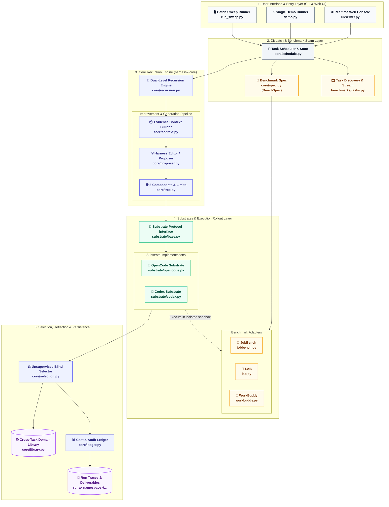

[English](ARCHITECTURE.md) | [简体中文](ARCHITECTURE_zh.md)

# Harness² Architecture & Recursive Execution Guide

Harness² (*Recursive Agent Harnessing for an Open World*) is a plug-and-play framework for **recursive agent harnessing** in an open world, optimizing the system around an LLM (**the harness**: prompts, tools, memory, skills, and orchestration) while keeping model weights strictly frozen.

This guide provides three modernized, professionally styled Mermaid architectural and workflow diagrams, mapping directly to core modules and source files:
1. [Three-Axis Decoupled System Topology](#1-system-layering--three-axis-architecture)
2. [Dual-Level Recursion Execution Lifecycle (Task-level & Harnessing-level)](#2-dual-level-recursion-execution-lifecycle)
3. [8 Editable Harness Components Runtime Topology](#3-the-8-editable-harness-components)
4. [Source Code Index & Engineering Invariants](#4-source-code-index--engineering-invariants)

---

## 1. System Layering & Three-Axis Architecture

Harness² strictly enforces a **Three-Axis Orthogonal Separation**:
* **Method Axis**: Recursion schedules, prompts, evidence packaging, unsupervised blind selection, and cross-task library.
* **Substrate Axis**: Agent execution framework (e.g. OpenCode, Codex), completely free of benchmark logic.
* **Benchmark Axis**: Static task specification ([`BenchSpec`](../harness2/core/spec.py)) and dataset adapters. Grader rubrics and ground truth are strictly isolated from the improver.

### 1.1 System Architecture & Code Mapping Diagram

### 1.2 Module Responsibilities

| Layer | Key Source File | Responsibility |
| :--- | :--- | :--- |
| **Entry & UI** | [`harness2/cli/run_sweep.py`](file:///Users/sienchen/Documents/github_project/Harness2/harness2/cli/run_sweep.py) [`harness2/ui/server.py`](file:///Users/sienchen/Documents/github_project/Harness2/harness2/ui/server.py) | CLI argument parsing, SSE event broadcasting, and the interactive web workbench. |
| **Scheduling** | [`harness2/core/schedule.py`](file:///Users/sienchen/Documents/github_project/Harness2/harness2/core/schedule.py) | Task stream sequencing, file-locked state merging, and fingerprint-validated checkpoint resumption. |
| **Recursion** | [`harness2/core/recursion.py`](file:///Users/sienchen/Documents/github_project/Harness2/harness2/core/recursion.py) | Schedules $4k$ candidate rollouts and $3k$ improver sessions in parallel (`agg`) or sequential (`seq`) mode. |
| **Substrates** | [`harness2/substrate/base.py`](file:///Users/sienchen/Documents/github_project/Harness2/harness2/substrate/base.py) | Protocol contract for materializing and staging harness trees onto underlying agent runners. |
| **Benchmarks** | [`harness2/core/spec.py`](file:///Users/sienchen/Documents/github_project/Harness2/harness2/core/spec.py) | Declares task constraints and prompt templates without exposing measurement rubrics. |

---

## 2. Dual-Level Recursion Execution Lifecycle

Harness² pairs two levels of recursion:
1. **Task-level recursion**: Refines execution harnesses for the current task via **Propose–Probe–Compose**, comparing behavioral contrasts without ground-truth labels.
2. **Harnessing-level recursion**: Updates a persistent **Domain Library** with adopted harnesses and evidence-supported lessons to jumpstart future tasks in the same domain.

### 2.1 Recursion Lifecycle Flowchart

```mermaid
flowchart TD
    %% Custom Styling Palette
    classDef init fill:#f1f5f9,stroke:#64748b,stroke-width:1.5px,color:#0f172a,font-weight:600;
    classDef propose fill:#e0f2fe,stroke:#0284c7,stroke-width:1.5px,color:#0369a1,font-weight:600;
    classDef probe fill:#fef3c7,stroke:#d97706,stroke-width:1.5px,color:#92400e,font-weight:600;
    classDef compose fill:#eef2ff,stroke:#6366f1,stroke-width:1.5px,color:#3730a3,font-weight:600;
    classDef select fill:#ecfdf5,stroke:#10b981,stroke-width:1.5px,color:#065f46,font-weight:600;
    classDef reflect fill:#faf5ff,stroke:#a855f7,stroke-width:1.5px,color:#6b21a8,font-weight:600;
    classDef alert fill:#fff1f2,stroke:#f43f5e,stroke-width:1.5px,color:#9f1239,font-weight:bold;

    subgraph S1["Stage 1: Task Initialization & Base Sampling"]
        direction LR
        T_In[/"📥 Task Input: Task ID + Domain"/]:::init
        Lib_In[("📚 Read Domain Experience Library<br>INDEX.md (Historical Tasks)")]:::reflect
        Base_Roll(["🚀 Execute Base Probe: _roll_bases()<br>Collect baseline trajectory & deliverable RunView"]):::init

        T_In --> Lib_In
        T_In --> Base_Roll
    end

    subgraph S2["Stage 2: Propose–Probe Phase (Task-Level Recursion)"]
        direction TB
        Pack_Ev["📦 Assemble Evidence: context.build()<br>Merge base traces, deliverables, diffs & library lessons"]:::propose
        subgraph Proposers["Proposer Improvement Session (proposer.py)"]
            direction LR
            INV["🛡️ Invariant Proposal (INV Levers)<br>System prompt, guardrails, core tool guidance"]:::propose
            DOM["🛠️ Domain Proposal (DOM Levers)<br>Domain skills, specialized scripts, plugins"]:::propose
        end
        subgraph ValidationGate["Surface Validation & Staging"]
            direction LR
            CheckSurface{{"🔍 SurfaceSpec Validation<br>Component paths, regex, reserved scripts"}}:::probe
            FixRetry["⚠️ 1 In-context Retry (a2)<br>Falls back to base if invalid"]:::alert
            Mat["⚙️ Materialize to Substrate<br>Staging Directory"]:::probe
        end
        ProbeExec(["🧪 Parallel Candidate Rollouts: _roll_many()<br>Record trajectories and deliverable artifacts"]):::probe

        Pack_Ev --> INV
        Pack_Ev --> DOM
        INV --> CheckSurface
        DOM --> CheckSurface
        CheckSurface -- "Rejected" --> FixRetry
        CheckSurface -- "Accepted" --> Mat
        FixRetry --> Mat
        Mat --> ProbeExec
    end

    subgraph S3["Stage 3: Compose Phase & Mode Branching"]
        direction TB
        BranchDecision{{"🔀 Recursion Mode Selection"}}:::compose
        subgraph ModeBranches["Branch Implementations"]
            direction LR
            ParallelPath["⚡ Parallel Mode (agg)<br>2k candidates probed -> k independent merges"]:::compose
            SeqPath["🔄 Sequential Mode (seq)<br>k nested iterative rounds: c0 -> c1 -> ... -> ck"]:::compose
        end
        ComposerAction(["🧬 Harness Composer<br>prompts.aggregate / compose_round<br>Contrast probe behaviors, resolve regressions, synthesize final candidates"]):::compose
        FinalRollout(["🎯 Rollout Final Composed Harnesses<br>Deliverables for agg1..aggk or c1..ck"]):::compose

        BranchDecision --> ParallelPath
        BranchDecision --> SeqPath
        ParallelPath --> ComposerAction
        SeqPath --> ComposerAction
        ComposerAction --> FinalRollout
    end

    subgraph S4["Stage 4: Unsupervised Blind Selection"]
        direction LR
        AnonAction["🎲 Deterministic Hash Shuffle & Anonymization<br>assign_ids() -> A, B, C... (Eliminates position/label bias)"]:::select
        BlindJudge(["⚖️ Unsupervised Selector Model (No Ground Truth)<br>Evaluates outputs purely on internal consistency and quality"]):::select
        Adopted["🏆 Adopted Harness<br>(chosen_label: aggX or cX)"]:::select

        AnonAction --> BlindJudge
        BlindJudge --> Adopted
    end

    subgraph S5["Stage 5: Reflection & Continual Learning (Harnessing-Level Recursion)"]
        direction LR
        Reflector["💡 Extract Experience Tuple: &lt;experience&gt;<br>Cue (trigger context) + Lesson (rule) + Evidence (support)"]:::reflect
        UpdateLib[("📚 Persist to Domain Library<br>Update INDEX.md & harnesses/&lt;task&gt;/EXPERIENCE.md")]:::reflect
        NextStream["🚀 Continual Evolution: Auto-injected to subsequent domain tasks"]:::reflect

        Reflector --> UpdateLib
        UpdateLib --> NextStream
    end

    %% Cascade Inter-Stage Connections (Top-Down, No Cycles or Crossings)
    Base_Roll --> Pack_Ev
    Lib_In --> Pack_Ev
    ProbeExec --> BranchDecision
    FinalRollout --> AnonAction
    Adopted --> Reflector
```

### 2.2 Deep Dive into Key Mechanisms

1. **Contrastive Evidence Packaging**:
   - Built by [`context.build()`](file:///Users/sienchen/Documents/github_project/Harness2/harness2/core/context.py#L55). The proposer inspects not just a single trace, but behavioral contrasts between executions (diffs, tool call errors, and deliverable quality).
   - `assert_tree_has_no_grader_verdicts()` enforces absolute isolation against test leakage.
2. **Parallel (`agg`) vs. Sequential (`seq`)**:
   - **`run_parallel`**: Maximizes exploratory diversity. Samples $k$ INV and $k$ DOM proposals in parallel ($2k$ total), followed by $k$ independent compositions (`agg1` through `aggk`).
   - **`run_sequential`**: Focuses on deep iterative refinement. Each round $t$ refines $c_{t-1}$ into $c_t$ using candidate feedback from that round.
3. **Unsupervised Blind Selection**:
   - [`assign_ids()`](file:///Users/sienchen/Documents/github_project/Harness2/harness2/core/selection.py#L71) computes a SHA-1 seeded shuffle to randomize candidate names into `A`, `B`, `C`..., eliminating order and naming bias.
   - The selection prompt judges deliverables without ground-truth answers.

---

## 3. The 8 Editable Harness Components

A Harness wraps an agent model. Harness² decomposes this editable space into **eight components (c1 through c8)** grouped into 4 runtime roles:

```mermaid
flowchart LR
    %% Custom Styling Palette
    classDef context fill:#e0f2fe,stroke:#0284c7,stroke-width:1.5px,color:#0369a1,font-weight:600;
    classDef iface fill:#ecfdf5,stroke:#10b981,stroke-width:1.5px,color:#065f46,font-weight:600;
    classDef deleg fill:#fef3c7,stroke:#d97706,stroke-width:1.5px,color:#92400e,font-weight:600;
    classDef hook fill:#faf5ff,stroke:#a855f7,stroke-width:1.5px,color:#6b21a8,font-weight:600;
    classDef center fill:#f8fafc,stroke:#475569,stroke-width:2px,color:#0f172a,font-weight:bold;
    classDef env fill:#f1f5f9,stroke:#64748b,stroke-width:1.5px,color:#334155,font-weight:600;

    subgraph G_Input["1. Context Construction"]
        direction TB
        c1["c1: System Prompt<br>Foundational persona & instructions"]:::context
        c2["c2: Guardrails<br>Safety boundaries & operating rules"]:::context
        c3["c3: Memory<br>Persistent operational state"]:::context
        c6["c6: Skills<br>Domain-specific skill manuals"]:::context
    end

    subgraph G_Core["Core & Middleware Control"]
        direction TB
        Model(("🧠 Frozen LLM Core")):::center
        c8["c8: Plugins<br>Lifecycle hooks & event interceptors"]:::hook
        c8 -.->|"Event interception / enhancement"| Model
    end

    subgraph G_Output["2. Tool Interface & Delegation"]
        direction TB
        subgraph Sub_Tools["Tool Interface"]
            c4["c4: Tool Guidance<br>API interaction schemas"]:::iface
            c7["c7: Scripts<br>Python standalone helper scripts"]:::iface
        end
        subgraph Sub_Deleg["Delegation"]
            c5["c5: Subagents<br>Specialized subagent configurations"]:::deleg
        end
    end

    subgraph G_Target["Execution Environment & Target"]
        direction TB
        Env["💻 OS / Execution Sandbox"]:::env
        SubTasks["👥 Subtask Workspaces"]:::env
    end

    %% Unidirectional Horizontal Dataflow (Strict Left-to-Right, Zero Occlusion)
    G_Input ==>|"Constructs Inbound Context"| Model
    Model ==>|"Invokes tools"| Sub_Tools
    Model ==>|"Dispatches subtasks"| Sub_Deleg
    Sub_Tools -->|"Executes & captures output"| Env
    Sub_Deleg -->|"Coordinates execution"| SubTasks
```

### 3.1 Component Specifications

| ID | Component | Runtime Role | File Path Convention | Rules & Invariants |
| :--- | :--- | :--- | :--- | :--- |
| **c1** | **System Prompt** | Context | `AGENTS.md` / `config.toml` | Foundational agent persona; governed by char caps |
| **c2** | **Guardrails** | Context | `guardrails/` or marked prompt section | Operation boundaries; prevents unauthorized file deletion |
| **c3** | **Memory** | Context | `AGENTS.md` Memory section | Long-term operational state across invocations |
| **c4** | **Tool Guidance**| Interface | Tool instructions / docstrings | Clarifies API return structures and interaction schemas |
| **c5** | **Subagents** | Delegation | `sub_agents/<name>/AGENT.md` | Delegated roles matching `[a-z0-9_-]` regex |
| **c6** | **Skills** | Context | `skills/<name>/SKILL.md` | Frontmatter required; can include local `scripts/` |
| **c7** | **Scripts** | Interface | `scripts/<name>.py` | Valid standalone Python scripts; reserved names forbidden |
| **c8** | **Plugins** | Middleware | `plugins/<name>.ts` / hooks | Intercepts runtime events (e.g. `pre_tool_call`) |

> [!IMPORTANT]
> **Reserved Scripts Protection**: [`RESERVED_SCRIPTS`](file:///Users/sienchen/Documents/github_project/Harness2/harness2/core/tree.py#L34) (such as `read_doc.py`, `pack.py`, `unpack.py`) belong to benchmark test infrastructure and cannot be modified or deleted by proposals.

---

## 4. Source Code Index & Engineering Invariants

### 4.1 Key Source Files

| Category | File Path | Key Symbols | Responsibility |
| :--- | :--- | :--- | :--- |
| **Recursion** | [`harness2/core/recursion.py`](file:///Users/sienchen/Documents/github_project/Harness2/harness2/core/recursion.py) | [`run_parallel`](file:///Users/sienchen/Documents/github_project/Harness2/harness2/core/recursion.py#L343) [`run_sequential`](file:///Users/sienchen/Documents/github_project/Harness2/harness2/core/recursion.py#L452) `_run_stage` | Master orchestrator of the Propose-Probe-Compose task-level recursion. |
| **Selection** | [`harness2/core/selection.py`](file:///Users/sienchen/Documents/github_project/Harness2/harness2/core/selection.py) | [`Selection`](file:///Users/sienchen/Documents/github_project/Harness2/harness2/core/selection.py#L47) [`assign_ids`](file:///Users/sienchen/Documents/github_project/Harness2/harness2/core/selection.py#L71) `selection_pool` | Unsupervised blind evaluation, position-debiasing, and lesson reflection. |
| **Harness Tree**| [`harness2/core/tree.py`](file:///Users/sienchen/Documents/github_project/Harness2/harness2/core/tree.py) | [`SurfaceSpec`](file:///Users/sienchen/Documents/github_project/Harness2/harness2/core/tree.py#L41) `validate` `diff_summary` | White-list surface validation, structural diffing, and autotriggering. |
| **Library** | [`harness2/core/library.py`](file:///Users/sienchen/Documents/github_project/Harness2/harness2/core/library.py) | [`Library`](file:///Users/sienchen/Documents/github_project/Harness2/harness2/core/library.py#L58) `add` `rebuild_index` | Domain knowledge store under `runs/<tag>/<mode>/<domain>/`. |
| **Context** | [`harness2/core/context.py`](file:///Users/sienchen/Documents/github_project/Harness2/harness2/core/context.py) | [`build`](file:///Users/sienchen/Documents/github_project/Harness2/harness2/core/context.py#L55) `mission` | Packs executions, diffs, and historical experiences into evidence bundles. |
| **Scheduling** | [`harness2/core/schedule.py`](file:///Users/sienchen/Documents/github_project/Harness2/harness2/core/schedule.py) | [`Namespace`](file:///Users/sienchen/Documents/github_project/Harness2/harness2/core/schedule.py#L85) `run_sweep` `_resume` | Manages directory namespaces, concurrency pools, and resume locks. |
| **Substrate** | [`harness2/substrate/base.py`](file:///Users/sienchen/Documents/github_project/Harness2/harness2/substrate/base.py) | [`Substrate`](file:///Users/sienchen/Documents/github_project/Harness2/harness2/substrate/base.py#L48) `materialise` | Common interface for staging and launching agent harnesses. |
| **Prompts** | [`harness2/core/prompts.py`](file:///Users/sienchen/Documents/github_project/Harness2/harness2/core/prompts.py) | `propose` `aggregate` `compose_round` | Templated prompts for proposers, composers, and selectors. |
| **Ledger** | [`harness2/core/ledger.py`](file:///Users/sienchen/Documents/github_project/Harness2/harness2/core/ledger.py) | [`Ledger`](file:///Users/sienchen/Documents/github_project/Harness2/harness2/core/ledger.py#L32) | Tracks financial expenditures ($ USD), session calls, and rollout events. |

### 4.2 Engineering Invariants

1. **Omitted-is-Inherited**:
   A proposal only emits what it changes. Omitted files automatically carry forward from the fallback harness, ensuring minimal diffs and zero accidental deletions.
2. **Canonical Namespace Invariance**:
   All outputs adhere to `<bench>-<substrate>-<mode><k>[-s<seed>][-<tag>]`. Rerunning a sweep skips completed tasks safely by fingerprinting the adopted harness and verifying output integrity.
3. **Strict Evaluation Isolation**:
   Evaluator prompts never see ground truth. Measurement is clean and separated from the search loop.
