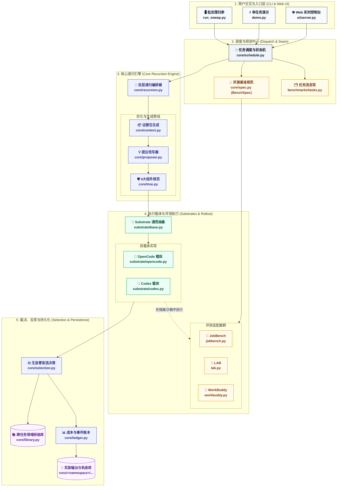
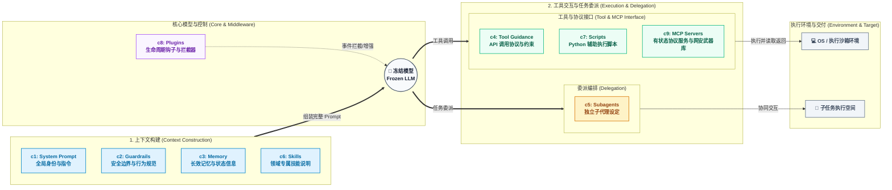

[English](ARCHITECTURE.md) | [简体中文](ARCHITECTURE_zh.md)

# Harness² 核心架构与递归执行指南

Harness²（*Recursive Agent Harnessing for an Open World*）是一个在**模型权重保持冻结**的前提下，对大模型 Agent 周围的支撑环境（**Harness**，包括提示词、工具、记忆、技能等）进行自主持续优化的框架。

本文档包含三张遵循现代专业科技风配色的 Mermaid 拓扑图与流程图，并深度关联代码库中的核心模块与源码文件：
1. [三轴解耦与系统架构拓扑图](#一系统分层与三轴解耦架构)
2. [双层递归执行生命周期图 (Task-level & Harnessing-level)](#二双层递归执行生命周期)
3. [9 大可编辑 Harness 组件运行时拓扑图](#三9-大可编辑-harness-组件体系)
4. [核心源文件速查与设计契约](#四核心源码文件索引与设计契约)

---

## 一、系统分层与三轴解耦架构

Harness² 严格遵循**三轴正交分离（Three Orthogonal Axes）**设计契约：
* **Method（优化方法轴）**：递归调度、对比证据打包、无监督盲选决策与跨任务经验库。
* **Substrate（执行载体轴）**：Agent 运行环境（如 OpenCode、Codex），与评测集逻辑完全解耦。
* **Benchmark（基准评测轴）**：任务规格（[`BenchSpec`](../backend/harness2/core/spec.py)）与数据集适配器，严禁泄露评测标准给优化器。

### 1.1 系统架构与代码映射拓扑图

### 1.2 架构模块职责对照表

| 层次分区 | 关键源文件 | 核心职责 |
| :--- | :--- | :--- |
| **入口控制** | [`harness2/cli/run_sweep.py`](../backend/harness2/cli/run_sweep.py) [`harness2/ui/server.py`](../backend/harness2/ui/server.py) | CLI 批量扫参启动、SSE 实时事件流推送与可视化 Web 控制台服务 |
| **调度中枢** | [`harness2/core/schedule.py`](../backend/harness2/core/schedule.py) | 领域流序调度、文件锁原子状态写入与带指纹校验的断点续跑（Resume） |
| **递归核心** | [`harness2/core/recursion.py`](../backend/harness2/core/recursion.py) | 组织 Task-level 递归（$4k$ 次 Rollout 与 $3k$ 次提议阶段）及并行/串行分支 |
| **载体隔离** | [`harness2/substrate/base.py`](../backend/harness2/substrate/base.py) | 定义 `Substrate` 协议，将组件树安全物化（Materialize）到执行沙箱环境 |
| **基准隔离** | [`harness2/core/spec.py`](../backend/harness2/core/spec.py) | 声明任务属性与无监督提示词模板，确保评测细则与 Ground Truth 绝对物理隔离 |

---

## 二、双层递归执行生命周期

Harness² 的核心创新在于将两层递归机制结合：
1. **任务级递归 (Task-level recursion)**：在单任务执行中，通过 **Propose–Probe–Compose** 循环探索与融合 Harness，无需任何真实标签（Ground Truth）。
2. **驾驭级递归 (Harnessing-level recursion)**：跨任务将采纳 Harness 与经验教训沉淀进 **领域经验库 (Library)**，在后续任务冷启动时自动注入。

### 2.1 递归生命周期流程图

```mermaid
flowchart TD
    %% Custom Styling Palette
    classDef init fill:#f1f5f9,stroke:#64748b,stroke-width:1.5px,color:#0f172a,font-weight:600;
    classDef propose fill:#e0f2fe,stroke:#0284c7,stroke-width:1.5px,color:#0369a1,font-weight:600;
    classDef probe fill:#fef3c7,stroke:#d97706,stroke-width:1.5px,color:#92400e,font-weight:600;
    classDef compose fill:#eef2ff,stroke:#6366f1,stroke-width:1.5px,color:#3730a3,font-weight:600;
    classDef select fill:#ecfdf5,stroke:#10b981,stroke-width:1.5px,color:#065f46,font-weight:600;
    classDef reflect fill:#faf5ff,stroke:#a855f7,stroke-width:1.5px,color:#6b21a8,font-weight:600;
    classDef alert fill:#fff1f2,stroke:#f43f5e,stroke-width:1.5px,color:#9f1239,font-weight:bold;

    subgraph S1["阶段 1：初始化与基线采样 (Task Initialization)"]
        direction LR
        T_In[/"📥 任务接入: Task ID + 领域 Domain"/]:::init
        Lib_In[("📚 读取领域经验库<br>INDEX.md (前序任务累积)")]:::reflect
        Base_Roll(["🚀 执行基线探针: _roll_bases()<br>产出初始轨迹与未调优交付物 RunView"]):::init

        T_In --> Lib_In
        T_In --> Base_Roll
    end

    subgraph S2["阶段 2：Propose–Probe 提议与探针阶段 (Task-level Recursion)"]
        direction TB
        Pack_Ev["📦 组装上下文证据包: context.build()<br>聚合基线轨迹、产物切片、Diff 与经验库"]:::propose
        subgraph Proposers["Proposer 改写引擎 (proposer.py)"]
            direction LR
            INV["🛡️ 不变性提议 (INV Levers)<br>System Prompt、Guardrails、标准工具指导"]:::propose
            DOM["🛠️ 领域性提议 (DOM Levers)<br>专有技能 Skills、执行脚本 Scripts、Plugins"]:::propose
        end
        subgraph ValidationGate["校验与沙箱物化"]
            direction LR
            CheckSurface{{"🔍 SurfaceSpec 校验<br>路径/正则/保留脚本"}}:::probe
            FixRetry["⚠️ 1次带错重试 (a2)<br>仍失败则回退基线"]:::alert
            Mat["⚙️ 物化至 Substrate<br>临时执行沙箱"]:::probe
        end
        ProbeExec(["🧪 并发探针试跑: _roll_many()<br>收集各候选 Harness 执行轨迹与产物"]):::probe

        Pack_Ev --> INV
        Pack_Ev --> DOM
        INV --> CheckSurface
        DOM --> CheckSurface
        CheckSurface -- "校验未通过" --> FixRetry
        CheckSurface -- "校验通过" --> Mat
        FixRetry --> Mat
        Mat --> ProbeExec
    end

    subgraph S3["阶段 3：Compose 融合与模式分支 (Parallel vs Sequential)"]
        direction TB
        BranchDecision{{"🔀 递归模式选择"}}:::compose
        subgraph ModeBranches["分支实现"]
            direction LR
            ParallelPath["⚡ 并行模式 (agg)<br>2k 候选并发探针 -> k 路独立融合"]:::compose
            SeqPath["🔄 串行模式 (seq)<br>k 轮链式深化: c0 -> c1 -> ... -> ck"]:::compose
        end
        ComposerAction(["🧬 Harness 融合 (Composer)<br>prompts.aggregate / compose_round<br>对比各路探针表现，剔除退化缺陷，融合成最终候选"]):::compose
        FinalRollout(["🎯 最终候选项探针试跑<br>生成候选交付物 (agg1..aggk 或 c1..ck)"]):::compose

        BranchDecision --> ParallelPath
        BranchDecision --> SeqPath
        ParallelPath --> ComposerAction
        SeqPath --> ComposerAction
        ComposerAction --> FinalRollout
    end

    subgraph S4["阶段 4：无监督盲选决策 (Blind Selection)"]
        direction LR
        AnonAction["🎲 确定性哈希打乱匿名化<br>assign_ids() -> A, B, C... 消除命名与位置偏差"]:::select
        BlindJudge(["⚖️ 无监督评审模型 (No Ground Truth)<br>基于交付物完整性与自洽性做出终审裁决"]):::select
        Adopted["🏆 采纳胜出 Harness<br>(chosen_label: aggX 或 cX)"]:::select

        AnonAction --> BlindJudge
        BlindJudge --> Adopted
    end

    subgraph S5["阶段 5：经验反思与跨任务持续学习 (Harnessing-level Recursion)"]
        direction LR
        Reflector["💡 经验元组提炼: &lt;experience&gt;<br>Cue (触发条件) + Lesson (核心经验) + Evidence (论据)"]:::reflect
        UpdateLib[("📚 沉淀至领域经验库<br>写入 INDEX.md 与 EXPERIENCE.md")]:::reflect
        NextStream["🚀 持续进化: 自动注入同领域后续任务先验"]:::reflect

        Reflector --> UpdateLib
        UpdateLib --> NextStream
    end

    %% 阶段级单向流动连线 (无越级回环与交叉遮挡)
    Base_Roll --> Pack_Ev
    Lib_In --> Pack_Ev
    ProbeExec --> BranchDecision
    FinalRollout --> AnonAction
    Adopted --> Reflector
```

### 2.2 关键执行环节机制解析

1. **对比证据打包（Contrastive Evidence）**：
   - 由 [`context.build()`](../backend/harness2/core/context.py#L55) 统一组装。优化器不仅能看到基线或上一轮的运行轨迹，还能横向对比多个探针之间的代码修改和输出差异。
   - `assert_tree_has_no_grader_verdicts()` 严密扫描组件树，防止评分标准或判题结果渗入优化环境。
2. **并行模式 (`agg`) 与串行模式 (`seq`)**：
   - **`run_parallel`**：侧重广度探索。并发生成 $k$ 个 INV 和 $k$ 个 DOM（共 $2k$ 个候选），再由 $k$ 个独立的 Aggregator 合并出最终候选 `agg1` 到 `aggk`。
   - **`run_sequential`**：侧重深度演进。以 $c_{t-1}$ 为基准展开第 $t$ 轮优化，经提议、探针试跑后融合成 $c_t$，逐轮迭代直到 $c_k$。
3. **无监督盲选（Unsupervised Blind Selection）**：
   - 模型评估极易受到候选顺序（Position Bias）与标签命名的先验干扰。[`assign_ids()`](../backend/harness2/core/selection.py#L71) 使用确定性哈希种子将标签随机映射为 `A`, `B`, `C` 等匿名代号。
   - 裁决完全基于交付物内容本身，不需要基准测试的标注答案。

---

## 三、9 大可编辑 Harness 组件体系

在 Harness² 中，Harness 是包围在模型周围的执行环境。框架抽象出 **9 大可编辑组件（c1 ~ c9）**，分为 4 种运行时角色：

### 3.1 组件定义与物理存储规范

| 编号 | 组件名称 | 运行时角色 | 文件路径规范 | 编辑规则与安全约束 |
| :--- | :--- | :--- | :--- | :--- |
| **c1** | **System Prompt** | 上下文构建 | `AGENTS.md` / `config.toml` | 基础行为与身份定义；受字数配额保护 |
| **c2** | **Guardrails** | 上下文构建 | `guardrails/` 或提示词专属段 | 防越界操作约束，禁止删除保护目录 |
| **c3** | **Memory** | 上下文构建 | `AGENTS.md` 中的 Memory 段 | 跨交互周期事实记忆，受长度上限限制 |
| **c4** | **Tool Guidance**| 工具接口 | 工具配置文件与使用指引段落 | 阐述 API 返回结构与调用规范 |
| **c5** | **Subagents** | 委派编排 | `sub_agents/<name>/AGENT.md` | 子代理身份定义，需符合 `[a-z0-9_-]` 命名 |
| **c6** | **Skills** | 上下文构建 | `skills/<name>/SKILL.md` | 必须包含规范 Frontmatter；支持自带 `scripts/` |
| **c7** | **Scripts** | 工具接口 | `scripts/<name>.py` | 必须为有效 Python 代码；预留脚本不可篡改 |
| **c8** | **Plugins** | 中间件 | `plugins/<name>.ts` / hooks 文件 | 钩子事件（如 `pre_tool_call`）拦截控制 |
| **c9** | **MCP Servers** | 协议与有状态工具 | `mcp/servers.json` + `mcp/<name>.py` | 跨基座原生 Tool Schema 注册与有状态服务；受数量与语法校验约束 |

> [!IMPORTANT]
> **保留脚本防篡改**：[`RESERVED_SCRIPTS`](../backend/harness2/core/tree.py#L34)（如 `read_doc.py`、`pack.py`、`unpack.py`）属于基准基础设施，Proposer 提议修改时会被 [`validate`](../backend/harness2/core/tree.py#L122) 严格拦截。

---

## 四、核心源码文件索引与设计契约

### 4.1 核心源文件索引

| 模块类别 | 文件绝对路径 | 核心类 / 函数 / 契约 | 架构地位 |
| :--- | :--- | :--- | :--- |
| **递归编排** | [`harness2/core/recursion.py`](../backend/harness2/core/recursion.py) | [`run_parallel`](../backend/harness2/core/recursion.py#L343) [`run_sequential`](../backend/harness2/core/recursion.py#L452) `_run_stage` | Task-level 递归核心调度器，组织多路 Propose、Probe 与 Compose |
| **盲选反思** | [`harness2/core/selection.py`](../backend/harness2/core/selection.py) | [`Selection`](../backend/harness2/core/selection.py#L47) [`assign_ids`](../backend/harness2/core/selection.py#L71) `selection_pool` | 稳定哈希匿名置换、无监督对比评审与经验元组提取 |
| **组件树契约**| [`harness2/core/tree.py`](../backend/harness2/core/tree.py) | [`SurfaceSpec`](../backend/harness2/core/tree.py#L41) `validate` `diff_summary` | 定义 8 大组件白名单边界、差异计算与增量合并原则 |
| **领域经验库**| [`harness2/core/library.py`](../backend/harness2/core/library.py) | [`Library`](../backend/harness2/core/library.py#L58) `add` `rebuild_index` | 负责 `runs/<tag>/<mode>/<domain>/` 跨任务知识沉淀与索引维护 |
| **证据组装** | [`harness2/core/context.py`](../backend/harness2/core/context.py) | [`build`](../backend/harness2/core/context.py#L55) `mission` | 汇集运行轨迹、交付物、组件 Diff 与反思历史并打包成提议上下文 |
| **调度与续跑**| [`harness2/core/schedule.py`](../backend/harness2/core/schedule.py) | [`Namespace`](../backend/harness2/core/schedule.py#L85) `run_sweep` `_resume` | 管理规范化命名空间，提供原子锁写入与强指纹校验断点续跑 |
| **载体适配** | [`harness2/substrate/base.py`](../backend/harness2/substrate/base.py) | [`Substrate`](../backend/harness2/substrate/base.py#L48) [`Install`](../backend/harness2/substrate/base.py#L27) | 执行框架抽象契约，负责组件树到原生环境的 Staging 物化 |
| **提示词库** | [`harness2/core/prompts.py`](../backend/harness2/core/prompts.py) | `propose` `aggregate` `compose_round` | 存储提议器、聚合器与评审器的结构化提示词模板 |
| **审计记账** | [`harness2/core/ledger.py`](../backend/harness2/core/ledger.py) | [`Ledger`](../backend/harness2/core/ledger.py#L32) | 严格记录每次提议的 USD 成本消耗、API 调用次数与探针状态 |

### 4.2 核心工程设计契约

1. **增量覆盖原则（Omitted-is-Inherited）**：
   提议器（Proposer）返回的代码树只包含发生变更的文件。未明确修改的组件，一律透明继承自 fallback 基线，防止全量重写带来的漂移。
2. **确定性命名空间规范（Canonical Namespacing）**：
   实验输出目录格式必须严格遵循 `<bench>-<substrate>-<mode><k>[-s<seed>][-<tag>]`，例如 `jb-oc-agg1-s7`。该命名空间同时作为全局任务 ID 前缀，确保实验可复现与无缝断点恢复。
3. **安全隔离（No Leakage Guard）**：
   评测细则（`RUBRICS.json`、`rubric.txt`）以及打分器输出被物理剥离在优化器证据池之外。优化过程仅凭 Agent 执行交互与最终交付物质量自我进化。
